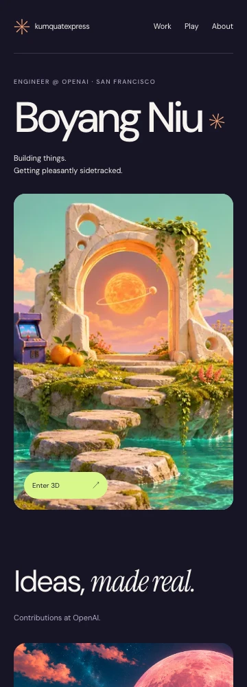

# Round 01: remove decorative commentary

This candidate removes decorative labels and redundant copy, retaining one short introductory line. The artwork, palette, underlying layout, projects, and interactions stay in place. The live site is unchanged.

## First viewport

### Desktop

| Current live                                                               | Candidate                                                                      |
| -------------------------------------------------------------------------- | ------------------------------------------------------------------------------ |
|  |  |

### Phone

| Current live                                                         | Candidate                                                                |
| -------------------------------------------------------------------- | ------------------------------------------------------------------------ |
|  |  |

## Full-page comparison

- Desktop: [current live](baseline-desktop.webp) · [candidate](candidate-desktop.webp)
- Phone: [current live](baseline-phone.webp) · [candidate](candidate-phone.webp)

## What the critique changed

The first pass also removed the short personal introduction. All three independent paired reviewers preferred its reduced annotation but flagged lost voice/context. A second comparison restored only “Building things. Getting pleasantly sidetracked.” All three narrowly preferred that refinement. It costs some vertical space on phone and remains a broad statement rather than a specific personal detail.

The reviewers still found **too many competing images and a conventional section stack** in both. This is a candidate for the copy-noise complaint, not a solution to the overall design. Model agreement selects what to show; Boyang's feedback decides what to keep.

- [First deletion pass, desktop](deletions-desktop-top.webp) · [phone](deletions-phone-top.webp)
- [Raw critique summary, hypotheses and validation](record.md)
- [Principles and iteration loop](../principles.md)

## Actual browser inspections

The candidate was subsequently run on all three machines, with independently captured peer opinions and interaction evidence. [Read the runtime review and machine reports](runtime-review.md). No additional application change was made.
